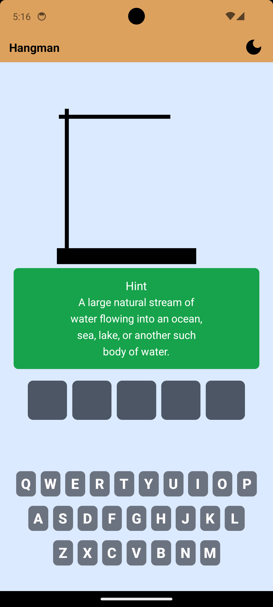

<div align="center">
  
  <h1>Hangman AI</h1>
  <p>
    A mobile & web word-guessing game powered by <b>Google Gemini AI</b> with dynamic word & hint generation.<br/>
    Built using <b>React Native (Expo)</b> and a robust <b>Node.js + Express</b> backend.
  </p>
  <br/>
  
</div>

---

## 🚀 Features

- 🔤 **AI-Generated Gameplay**: Dynamic words and contextual hints powered by Google Gemini with live model cascading.
- 🎨 **Polished UI & Animations**: Responsive SVG hangman drawing, animated end-game modal, and interactive keyboard with guess feedback.
- 🔄 **Offline Fallback Pool**: Built-in 12-word fallback pool ensuring zero downtime during API latency or rate limits.
- 🌙 **Light & Dark Mode**: Seamless theme switching directly from the app bar.
- 🛡️ **Secure Architecture**: API keys kept strictly server-side on Node.js backend — zero client leaks.

---

## 📲 Download the App

👉 [Click to Download Hangman AI (APK)](https://expo.dev/artifacts/eas/pRZijjM86884K5pqutW2Ra.apk)

---

## 🛠️ Getting Started

### 1. Clone the repo

```bash
git clone https://github.com/Kesicode/Hangman-AI.git
cd hangman-ai
```

### 2. Backend (Node + Express + Gemini AI)

```bash
cd ai
npm install
```

Create a `.env` file inside the `ai/` folder:

```env
GOOGLE_API_KEY=your_google_gemini_api_key
PORT=5000
```

Start the backend server:

```bash
node app.js
```

> The backend runs at `http://localhost:5000`

---

### 3. Frontend (Expo React Native)

In the root project directory:

```bash
npm install
npx expo start --web
```

> Opens at `http://localhost:8081` in your browser. You can also scan the QR code using Expo Go on your mobile device.

---

## 🌐 API Endpoints

| Method | Endpoint    | Description                                              |
| ------ | ----------- | -------------------------------------------------------- |
| GET    | `/gameData` | Generate a new word + hint using Gemini (with fallback)  |
| GET    | `/health`   | Health check endpoint returning status and active models |

---

## 📦 Tech Stack

**Frontend**:
- React Native
- Expo Router
- NativeWind (Tailwind CSS)
- React Native SVG & Animatable

**Backend**:
- Node.js
- Express
- Google Gemini API (`@google/generative-ai`)

---

## 🤝 Contributing

Pull requests are welcome! For major changes, please open an issue first to discuss what you would like to change.

---

## 📄 License

This project is licensed under the MIT License.

---

## ✨ Credits

- **[Kesicode](https://github.com/Kesicode)**
- **Google Gemini AI** – for powering intelligent word generation
- **Expo & React Native** – for cross-platform UI
